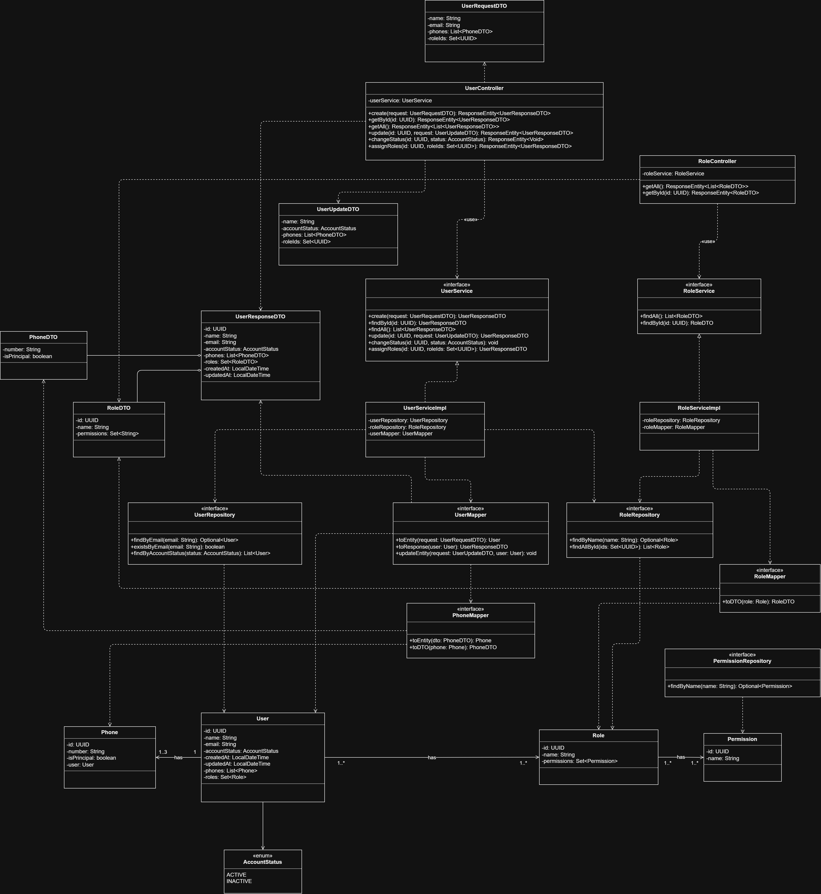
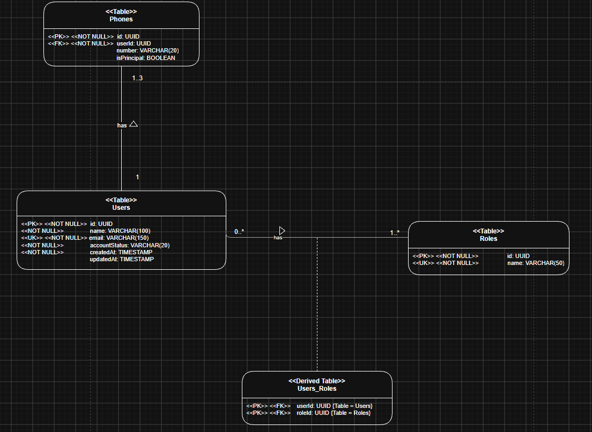

# oficioya-users

# Microservicio de usuarios

## Descripción del microservicio

El microservicio de usuarios se encarga de gestionar la información general de la persona y su cuenta dentro de la plataforma, independientemente de si actúa como Contratante, Trabajador o ambos, o Administrador.

Por lo tanto, debe llevar a cabo qué campos de visualización debe tener el registro y perfil de la cuenta de los distintos usuarios especificándolos detalladamente.

## Alcance del microservicio

* Operaciones CRUD sobre los usuarios del sistema.
* Perfil de usuario.

## Diagrama de clases

## Diagrama Entidad - Relación

