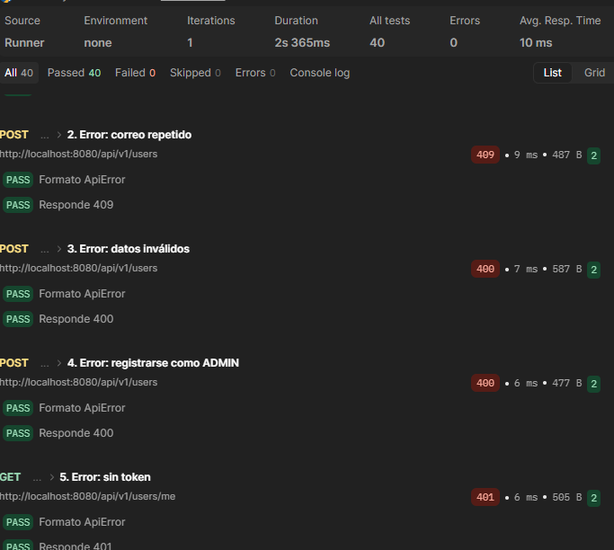
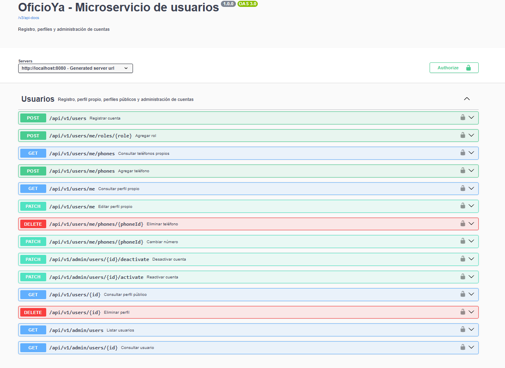

# Criterios de aceptación del microservicio de usuarios

Cada requerimiento funcional tiene sus criterios en formato **Dado / Cuando / Entonces**. Todos están automatizados en
[`UserAcceptanceTest`](../../src/test/java/edu/eci/dosw/oficioya_users/acceptance/UserAcceptanceTest.java), que levanta la
aplicación completa (seguridad JWT, controlador, servicio y base de datos H2) y llama a los endpoints como lo haría el front.

Para ejecutarlas:

```bash
mvn test -Dtest=UserAcceptanceTest
```

## Evidencias

Además de las pruebas automatizadas, la [colección de Postman](../oficioya-users.postman_collection.json) recorre los mismos
requerimientos con 35 peticiones, incluidos los endpoints de teléfonos, los que usa Identity (rol `SERVICE`) y el catálogo de zonas.
Ejecutada completa (*Run collection*), pasan las 73 pruebas:



Documentación de los endpoints en Swagger (`/swagger-ui.html`):



## RF-01 Registrar cuenta (`POST /api/v1/users`)

| # | Dado                                              | Cuando                                                                                                                                      | Entonces                                                                |
|---|---------------------------------------------------|---------------------------------------------------------------------------------------------------------------------------------------------|-------------------------------------------------------------------------|
| 1 | Un correo que no está registrado                  | Me registro con nombre, un teléfono principal y el rol CONTRATANTE                                                                          | Recibo 201 y la cuenta queda Activa con ese rol y el correo enmascarado |
| 2 | Un correo que no está registrado                  | Me registro como TRABAJADOR y CONTRATANTE                                                                                                   | La cuenta tiene ambos roles                                             |
| 3 | Un correo ya registrado (sin importar mayúsculas) | Intento registrarme con él                                                                                                                  | Recibo 409                                                              |
| 4 | —                                                 | Intento registrarme con el rol ADMIN                                                                                                        | Recibo 400                                                              |
| 5 | —                                                 | Me registro con dos teléfonos principales                                                                                                   | Recibo 400                                                              |
| 6 | —                                                 | Me registro con más de tres teléfonos o con datos inválidos (por ejemplo, un teléfono que no es un celular de 10 dígitos que empieza por 3) | Recibo 400                                                              |
| 7 | —                                                 | Intento registrarme sin token o con un token que no es SERVICE                                                                              | Recibo 401 o 403                                                        |
| 8 | Un perfil creado cuyo registro falló en Identity  | Identity pide eliminarlo (`DELETE /api/v1/users/{id}`) con token SERVICE                                                                    | Recibo 204 y el perfil deja de existir; con otro rol recibo 403         |

## RF-02 Agregar rol (`POST /api/v1/users/me/roles/{role}`)

| # | Dado | Cuando | Entonces |
|---|------|--------|----------|
| 1 | Un contratante activo | Agrega el rol TRABAJADOR | Su cuenta tiene ambos roles, sin crear otra cuenta |
| 2 | Un usuario que ya tiene el rol | Lo vuelve a agregar | Recibe 409 |
| 3 | Un usuario activo | Intenta agregarse el rol ADMIN | Recibe 400 |
| 4 | El administrador | Intenta agregarse un rol | Recibe 403 |

## RF-03 Consultar perfil propio (`GET /api/v1/users/me`)

| # | Dado | Cuando | Entonces |
|---|------|--------|----------|
| 1 | Un usuario activo | Consulta su perfil | Ve sus datos con correo (`*****@mail.com`) y teléfono (`******4567`) enmascarados |
| 2 | — | Consulta el perfil sin token | Recibe 401 |

## RF-04 Editar perfil propio (`PATCH /api/v1/users/me`)

| # | Dado | Cuando | Entonces |
|---|------|--------|----------|
| 1 | Un usuario activo | Cambia su nombre y sus teléfonos | Quedan guardados el nombre nuevo y solo los teléfonos nuevos; el correo no cambia |
| 2 | Un usuario activo | Envía teléfonos sin uno principal | Recibe 400 |

### Teléfonos del perfil propio (`/api/v1/users/me/phones`)

Estos criterios están automatizados en [`UserServiceTest`](../../src/test/java/edu/eci/dosw/oficioya_users/service/UserServiceTest.java)
y [`UserControllerTest`](../../src/test/java/edu/eci/dosw/oficioya_users/controller/UserControllerTest.java).

| # | Dado | Cuando | Entonces |
|---|------|--------|----------|
| 3 | Un usuario activo | Consulta sus teléfonos para editarlos (`GET`) | Recibe sus teléfonos completos (sin enmascarar) con su id |
| 4 | Un usuario activo con menos de 3 teléfonos | Agrega un teléfono (`POST`) | Queda guardado como adicional |
| 5 | Un usuario activo con 3 teléfonos | Agrega otro teléfono | Recibe 400 |
| 6 | Un usuario activo | Agrega un número que ya tiene registrado | Recibe 409 |
| 7 | Un usuario activo | Agrega un número que no es un celular de 10 dígitos que empieza por 3 | Recibe 400 con el mensaje "Ingrese un teléfono válido" |
| 8 | Un usuario activo | Modifica el número de un teléfono (`PATCH /{phoneId}`) | Queda guardado el número nuevo y el teléfono conserva su tipo (principal o adicional) |
| 9 | Un usuario activo | Modifica un teléfono que no existe | Recibe 404 |
| 10 | Un usuario activo | Elimina un teléfono adicional (`DELETE /{phoneId}`) | El teléfono deja de estar en la cuenta |
| 11 | Un usuario activo | Intenta eliminar el teléfono principal | Recibe 400 |

## RF-05 Consultar perfil público (`GET /api/v1/users/{id}`)

| # | Dado | Cuando | Entonces |
|---|------|--------|----------|
| 1 | Otro usuario activo | Consulto su perfil | Solo veo id, nombre y roles (sin correo ni teléfonos) |
| 2 | Un usuario desactivado | Consulto su perfil público | Recibo 404 |
| 3 | Que mi propia cuenta está desactivada | Consulto un perfil público | Recibo 403 |

## RF-06 Desactivar cuenta (`PATCH /api/v1/admin/users/{id}/deactivate`)

| # | Dado | Cuando | Entonces |
|---|------|--------|----------|
| 1 | Un usuario activo | El admin lo desactiva con motivo | La cuenta queda Inactiva y el usuario recibe 403 al usar su perfil |
| 2 | Un usuario activo | El admin lo desactiva sin motivo | Recibe 400 |
| 3 | Una cuenta ya inactiva | El admin la vuelve a desactivar | Recibe 409 |
| 4 | El administrador | Intenta desactivar su propia cuenta | Recibe 403 |
| 5 | Un usuario que no es admin | Intenta desactivar una cuenta | Recibe 403 |
| 6 | Un usuario activo | El admin lo desactiva con un motivo de menos de 10 caracteres | Recibe 400 (automatizado en `UserControllerTest`) |

## RF-07 Reactivar cuenta (`PATCH /api/v1/admin/users/{id}/activate`)

| # | Dado | Cuando | Entonces |
|---|------|--------|----------|
| 1 | Un usuario inactivo | El admin lo reactiva con motivo | La cuenta queda Activa y el usuario vuelve a usar su perfil |
| 2 | Una cuenta ya activa | El admin la reactiva | Recibe 409 |

## RF-08 Consultar información completa (`GET /api/v1/admin/users`, `GET /api/v1/admin/users/{id}`)

| # | Dado | Cuando | Entonces |
|---|------|--------|----------|
| 1 | Un usuario registrado | El admin lo consulta | Ve correo, teléfonos, estado y fechas sin enmascarar |
| 2 | Cuentas registradas | El admin lista los usuarios | Aparecen las cuentas registradas |
| 3 | Un id que no existe | El admin lo consulta | Recibe 404 |
| 4 | Un usuario que no es admin | Consulta la información completa | Recibe 403 |

## RF-09 Consultar el catálogo de zonas (`GET /api/v1/zones`)

| # | Dado | Cuando | Entonces |
|---|------|--------|----------|
| 1 | — | Consulto las zonas sin token | Recibo 200 con los 25 barrios (id, nombre y localidad) ordenados por id |
| 2 | Unos ids, algunos repetidos o inexistentes (`?ids=13,2,2,999`) | Los consulto | Recibo solo las zonas que existen, sin repetidas y ordenadas por id |
| 3 | — | Envío un id que no es número | Recibo 400 |
| 4 | Más de 50 ids distintos | Los consulto | Recibo 400 (automatizado en `ZoneServiceTest` y `ZoneControllerTest`) |

## RF-10 Consultar varios usuarios a la vez (`GET /api/v1/users?ids=…`)

| # | Dado | Cuando | Entonces |
|---|------|--------|----------|
| 1 | Cuentas activas | Las consulto por sus ids con cualquier rol (incluido `SERVICE`) | Recibo sus datos públicos |
| 2 | Una cuenta inactiva o un id que no existe | Lo incluyo en los ids | No aparece en la respuesta |
| 3 | Más de 50 ids | Los consulto | Recibo 400 |
| 4 | — | Consulto sin token | Recibo 401 |
