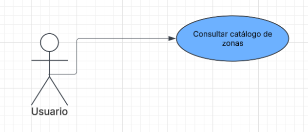
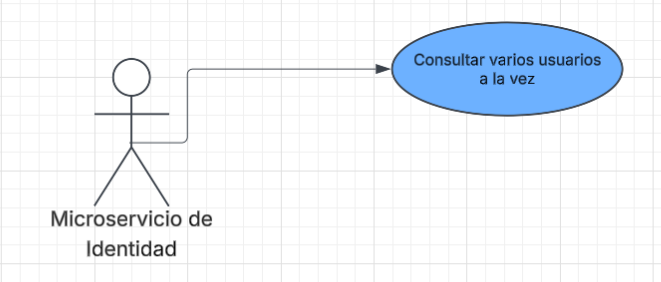
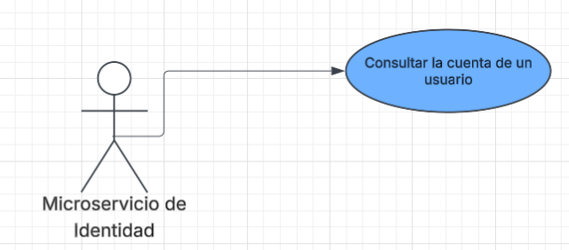

# 📄 Requerimientos del sistema en base al dominio de usuarios

## 1. Lista general de requerimientos

El sistema de OficioYa tiene los siguientes requerimientos (descripción a alto nivel):

### 1.1 Requerimientos funcionales

El sistema de OficioYa debe tener la capacidad de:

1. Permitir registrar un usuario con los datos necesarios. En el registro decide si quiere contratar, ofrecer su oficio o ambas cosas
2. Un mismo usuario puede agregar el rol que no eligió (contratante o trabajador) sin crear otro usuario
3. Consultar su propio perfil con la información registrada en la plataforma
4. Editar ciertas secciones principales del perfil (excepto las que están ocultas)
5. Consultar el perfil de otro usuario, mostrando información básica de acuerdo al tipo de rol
6. El administrador puede desactivar una cuenta si sucede algún conflicto o mal uso de los servicios que ofrece la página web
7. El administrador es capaz de reactivar una cuenta cuando el estado de la cuenta de un usuario esté inactivo
8. El administrador consulta el perfil de una cuenta 
9. Consultar el catálogo de zonas (barrios) donde los trabajadores ofrecen sus servicios
10. Otros microservicios consultan el nombre y rol(es) de varios usuarios a la vez
11. Otros microservicios pueden consultar una cuenta de un usuario, ya sea por correo u id y su estado (activa o inactiva)

### 1.2 Requerimientos no funcionales

El sistema de OficioYa debe tener:

1. Correo y teléfono de trabajadores y contratantes deben estar ocultos para todos los usuarios (excepto para el administrador)
2. El administrador tiene acceso a la información completa (incluso las ocultas) de un usuario
3. Las acciones del administrador (desactivar y reactivar cuentas) quedan registradas en el archivo de log con su motivo
4. Cobertura de pruebas unitarias de mínimo el 80%
5. En el front, los campos obligatorios se marcan con `*` y los campos de texto muestran su longitud máxima (y mínima cuando aplica)
6. Mientras el front carga la información o si el back no responde, se muestra un esqueleto de carga (rectángulos grises) en lugar de un mensaje de error suelto

### 1.3 Criterios de aceptación

Los criterios de aceptación de cada requerimiento funcional están en [Criterios de aceptación](./acceptance-criteria.md).

## 2. Diagramas de caso de uso

### 2.1 Requerimiento Funcional 1

| Campo                        | Descripción                                                                                                                                                                                                                                                                                                                                                                                                                                                                                                                                                                                                                                                                                     |
|------------------------------|-------------------------------------------------------------------------------------------------------------------------------------------------------------------------------------------------------------------------------------------------------------------------------------------------------------------------------------------------------------------------------------------------------------------------------------------------------------------------------------------------------------------------------------------------------------------------------------------------------------------------------------------------------------------------------------------------|
| **ID**                       | RF-01                                                                                                                                                                                                                                                                                                                                                                                                                                                                                                                                                                                                                                                                                           |
| **Nombre del requerimiento** | Permitir registrar una cuenta con los datos necesarios.                                                                                                                                                                                                                                                                                                                                                                                                                                                                                                                                                                                                                                         |
| **Descripción**              | *El sistema debe permitir a un usuario registrar su información. El usuario elige si quiere contratar (contratante), ofrecer su oficio (trabajador) o ambas cosas*. El formulario del usuario debe quedar de la siguiente manera: [Requisito de datos del usuario](./data_user_requirements.md)                                                                                                                                                                                                                                                                                                                                                                                             |
| **Precondiciones**           | *El usuario no debe tener una cuenta previamente registrada con el mismo correo*                                                                                                                                                                                                                                                                                                                                                                                                                                                                                                                                                                                                                |
| **Actor**                    | *Usuario*                                                                                                                                                                                                                                                                                                                                                                                                                                                                                                                                                                                                                                                                                       |
| **Flujo principal**          | 1. El visitante ingresa al formulario de registro 2. El visitante diligencia nombre, correo, contraseña y teléfonos (principal obligatorio y hasta 2 adicionales) 3. El visitante elige "Quiero contratar", "Quiero ofrecer mi oficio" o "Quiero hacer ambas cosas" 4. El visitante envía el formulario 5. El microservicio de Identidad recibe los datos, valida la contraseña y le pide al microservicio de Usuarios crear la cuenta 6. El sistema valida formato y unicidad del correo, creando la cuenta en estado Activo con los roles elegidos 7. El microservicio de Identidad crea las credenciales con la contraseña 8. El sistema informa que el registro fue exitoso |
| **Poscondiciones**           | *Existe una cuenta en estado Activa con los roles elegidos (contratante, trabajador o ambos) y con los datos ingresados. El correo queda asociado únicamente a esa cuenta*                                                                                                                                                                                                                                                                                                                                                                                                                                                                                                                   |

### 2.2 Requerimiento Funcional 2

| Campo                        | Descripción                                                                                                                                                                                                                                                                |
|------------------------------|----------------------------------------------------------------------------------------------------------------------------------------------------------------------------------------------------------------------------------------------------------------------------|
| **ID**                       | RF-02                                                                                                                                                                                                                                                                      |
| **Nombre del requerimiento** | Agregar el otro rol a la cuenta.                                                                                                                                                                                                                                           |
| **Descripción**              | *El sistema debe permitir que un usuario agregue el rol que no eligió en el registro (trabajador o contratante) en la misma cuenta, sin crear otra. Los datos que ya tiene la cuenta (nombre, correo y teléfonos) se reutilizan* |
| **Precondiciones**           | *El usuario está autenticado y su cuenta está Activa*                                                                                                                                                                                                                      |
| **Actor**                    | *Usuario*                                                                                                                                                                                                                                                                  |
| **Flujo principal**          | 1. El usuario ingresa a su cuenta 2. Pulsa "Agregar rol de trabajador" (o "Agregar rol de contratante" si solo es trabajador) 3. El sistema le agrega el rol a la misma cuenta 4. Si agregó el rol de trabajador, el front lo lleva a completar su perfil de trabajador (microservicio de Trabajadores)                                |
| **Diagrama de caso de uso**  |                                                                                                                                                                                                                               |
| **Poscondiciones**           | *La cuenta tiene ambos roles. No se creó otra cuenta ni otro correo*                                                                                                                                       |

### 2.3 Requerimiento Funcional 3

| Campo                        | Descripción                                                                                                                                                                                                                                                                                                                    |
|------------------------------|--------------------------------------------------------------------------------------------------------------------------------------------------------------------------------------------------------------------------------------------------------------------------------------------------------------------------------|
| **ID**                       | RF-03                                                                                                                                                                                                                                                                                                                          |
| **Nombre del requerimiento** | Consultar el perfil propio.                                                                                                                                                                                                                                                                                                    |
| **Descripción**              | *El sistema debe permitir a un usuario consultar su propio perfil con la información registrada en la plataforma*                                                                                                                                                                                                              |
| **Precondiciones**           | *El usuario está autenticado y su cuenta está Activa*                                                                                                                                                                                                                                                                          |
| **Actor**                    | *Trabajador o Contratante*                                                                                                                                                                                                                                                                                                     |
| **Flujo principal**          | 1. El usuario ingresa a la sección Perfil 2. El sistema muestra los datos del perfil de cada uno de sus roles pero con correo y teléfonos ocultos de manera parcial (ej: *****@gmail.com, ******4567) 3. Los teléfonos se muestran separados: primero el teléfono principal y debajo la lista de teléfonos adicionales |
| **Diagrama de caso de uso**  |                                                                                                                                                                                                                                                                                     |
| **Poscondiciones**           | *El usuario ve todos los datos de su perfil. No se muestran datos de otros usuarios*                                                                                                                                                                                                                                           |

### 2.4 Requerimiento Funcional 4

| Campo                        | Descripción                                                                                                                                                                                                                                                                                                                                                                                                                                                                                                                                                                                                                                                                                                                                                                                                                                |
|------------------------------|--------------------------------------------------------------------------------------------------------------------------------------------------------------------------------------------------------------------------------------------------------------------------------------------------------------------------------------------------------------------------------------------------------------------------------------------------------------------------------------------------------------------------------------------------------------------------------------------------------------------------------------------------------------------------------------------------------------------------------------------------------------------------------------------------------------------------------------------|
| **ID**                       | RF-04                                                                                                                                                                                                                                                                                                                                                                                                                                                                                                                                                                                                                                                                                                                                                                                                                                      |
| **Nombre del requerimiento** | Editar el perfil propio.                                                                                                                                                                                                                                                                                                                                                                                                                                                                                                                                                                                                                                                                                                                                                                                                                   |
| **Descripción**              | *El sistema debe permitir que un usuario modifique los campos editables de su perfil*                                                                                                                                                                                                                                                                                                                                                                                                                                                                                                                                                                                                                                                                                                                                                      |
| **Precondiciones**           | *El usuario está autenticado y su cuenta está Activa*                                                                                                                                                                                                                                                                                                                                                                                                                                                                                                                                                                                                                                                                                                                                                                                      |
| **Actor**                    | *Trabajador o Contratante*                                                                                                                                                                                                                                                                                                                                                                                                                                                                                                                                                                                                                                                                                                                                                                                                                 |
| **Flujo principal**          | 1. El usuario ingresa a la sección Editar perfil 2. El sistema muestra el nombre y los teléfonos (principal y adicionales) con su valor actual; los teléfonos se ven ocultos (ej: ******4567) 3. El usuario modifica el nombre (máximo 100 caracteres) y pulsa Guardar 4. Para los teléfonos, el usuario puede: modificar un número (se edita a partir del número completo), agregar un número adicional (máximo 3 teléfonos en total) o eliminar un número adicional. El teléfono principal es obligatorio y no se puede eliminar. Cada cambio de teléfono se guarda al momento 5. El sistema valida los datos con las mismas reglas del registro (teléfono: celular de 10 dígitos que empieza por 3, sin números repetidos) 6. El sistema guarda los cambios. Con Cancelar se vuelve al perfil sin guardar el nombre |
| **Diagrama de caso de uso**  |                                                                                                                                                                                                                                                                                                                                                                                                                                                                                                                                                                                                                                                                                                                                                                                                  |
| **Poscondiciones**           | *El perfil muestra los valores nuevos. Los campos no editables conservan su valor. La cuenta conserva siempre un teléfono principal*                                                                                                                                                                                                                                                                                                                                                                                                                                                                                                                                                                                                                                                                                                       |

### 2.5 Requerimiento Funcional 5

| Campo                        | Descripción                                                                                                                                                                                                                |
|------------------------------|----------------------------------------------------------------------------------------------------------------------------------------------------------------------------------------------------------------------------|
| **ID**                       | RF-05                                                                                                                                                                                                                      |
| **Nombre del requerimiento** | Consultar el perfil público de otro usuario.                                                                                                                                                                               |
| **Descripción**              | *El sistema debe permitir consultar el perfil de otro usuario, mostrando información básica, según el rol sin mostrar correo y teléfono*                                                                                   |
| **Precondiciones**           | *El usuario está autenticado y su cuenta está Activa. La cuenta consultada existe y está Activa*                                                                                                                           |
| **Actor**                    | *Trabajador o Contratante*                                                                                                                                                                                                 |
| **Flujo principal**          | 1. El usuario selecciona un perfil desde un resultado de búsqueda o un enlace 2. El sistema obtiene los datos públicos del usuario seleccionado 3. El sistema muestra el perfil público según el rol de esa cuenta |
| **Diagrama de caso de uso**  |                                                                                                                                                                          |
| **Poscondiciones**           | *El usuario ve únicamente los campos públicos del perfil consultado*                                                                                                                                                       |

### 2.6 Requerimiento Funcional 6

| Campo                        | Descripción                                                                                                                                                                                                                                                                                              |
|------------------------------|----------------------------------------------------------------------------------------------------------------------------------------------------------------------------------------------------------------------------------------------------------------------------------------------------------|
| **ID**                       | RF-06                                                                                                                                                                                                                                                                                                    |
| **Nombre del requerimiento** | Desactivar una cuenta.                                                                                                                                                                                                                                                                                   |
| **Descripción**              | *El sistema debe permitir que el administrador desactive una cuenta por conflicto o mal uso de la plataforma.*                                                                                                                                                                                           |
| **Precondiciones**           | *El administrador está autenticado. La cuenta seleccionada existe y está Activa*                                                                                                                                                                                                                         |
| **Actor**                    | *Administrador*                                                                                                                                                                                                                                                                                          |
| **Flujo principal**          | 1. El administrador selecciona la cuenta 2. El administrador solicita desactivarla 3. El administrador ingresa el motivo (obligatorio, entre 10 y 500 caracteres) 4. El sistema cambia el estado de la cuenta a Inactiva 5. El sistema registra la acción y su motivo en el log (RNF-03) |
| **Diagrama de caso de uso**  |                                                                                                                                                                                                                                                          |
| **Poscondiciones**           | La cuenta está en estado Inactiva y queda registrada en el log la acción con su motivo                                                                                                                                                                                                                   |

### 2.7 Requerimiento Funcional 7

| Campo                        | Descripción                                                                                                                                                                                                                                                                                           |
|------------------------------|-------------------------------------------------------------------------------------------------------------------------------------------------------------------------------------------------------------------------------------------------------------------------------------------------------|
| **ID**                       | RF-07                                                                                                                                                                                                                                                                                                 |
| **Nombre del requerimiento** | Reactivar una cuenta                                                                                                                                                                                                                                                                                  |
| **Descripción**              | El sistema debe permitir que el administrador reactive una cuenta Inactiva                                                                                                                                                                                                                            |
| **Precondiciones**           | El administrador está autenticado. La cuenta seleccionada existe y está Inactiva                                                                                                                                                                                                                      |
| **Actor**                    | Administrador                                                                                                                                                                                                                                                                                         |
| **Flujo principal**          | 1. El administrador selecciona la cuenta 2. El administrador solicita reactivarla 3. El administrador ingresa el motivo (obligatorio, entre 10 y 500 caracteres) 4. El sistema cambia el estado de la cuenta a Activa 5. El sistema registra la acción y su motivo en el log (RNF-03) |
| **Diagrama de caso de uso**  |                                                                                                                                                                                                                                                        |
| **Poscondiciones**           | La cuenta está en estado Activa, puede iniciar sesión y su perfil vuelve a ser consultable. Queda registrada en el log la acción con su motivo                                                                                                                                                        |

### 2.8 Requerimiento Funcional 8

| Campo                        | Descripción                                                                                                                                                                                                     |
|------------------------------|-----------------------------------------------------------------------------------------------------------------------------------------------------------------------------------------------------------------|
| **ID**                       | RF-08                                                                                                                                                                                                           |
| **Nombre del requerimiento** | Consultar el perfil completo de una cuenta                                                                                                                                                                      |
| **Descripción**              | El sistema debe permitir que el administrador consulte todos los datos de una cuenta, incluidos correo, teléfono, roles y estado, para atender reportes y disputas                                              |
| **Precondiciones**           | El administrador está autenticado. La cuenta seleccionada existe (Activa o Inactiva)                                                                                                                            |
| **Actor**                    | Administrador                                                                                                                                                                                                   |
| **Flujo principal**          | 1. El administrador selecciona la cuenta desde el listado de usuarios, donde el correo se ve oculto (ej: *****@ejemplo.com) 2. El sistema muestra todos los datos de la cuenta, con el correo completo  |
| **Diagrama de caso de uso**  |                                                                                                                                                                   |
| **Poscondiciones**           | El administrador ve todos los datos de la cuenta, incluidos los ocultos                                                                                                                                         |

### 2.9 Requerimiento Funcional 9

| Campo                        | Descripción                                                                                                                                                                                                                     |
|------------------------------|---------------------------------------------------------------------------------------------------------------------------------------------------------------------------------------------------------------------------------|
| **ID**                       | RF-09                                                                                                                                                                                                                           |
| **Nombre del requerimiento** | Consultar el catálogo de zonas                                                                                                                                                                                                  |
| **Descripción**              | El sistema debe ofrecer el catálogo de barrios de Bogotá (id, nombre y localidad de referencia) para que el front arme el selector de zona y el microservicio de Trabajadores valide las zonas que guarda (`GET /api/v1/zones`)  |
| **Precondiciones**           | Ninguna. El catálogo es público y no requiere token                                                                                                                                                                             |
| **Actor**                    | Visitante, usuario o microservicio de Trabajadores                                                                                                                                                                              |
| **Flujo principal**          | 1. El front o el microservicio pide el catálogo completo, o solo algunas zonas enviando sus ids (`?ids=1,2`, máximo 50) 2. El sistema devuelve las zonas ordenadas por id. Si se enviaron ids, devuelve solo las que existen, sin repetidas |
| **Diagrama de caso de uso** |  |
| **Poscondiciones**           | Quien consulta conoce las zonas. Comparando cuántos ids pidió con cuántas zonas recibió sabe si todas existen. El catálogo no cambia                                                                                             |

### 2.10 Requerimiento Funcional 10

| Campo                        | Descripción                                                                                                                                                                                                                                                |
|------------------------------|------------------------------------------------------------------------------------------------------------------------------------------------------------------------------------------------------------------------------------------------------------|
| **ID**                       | RF-10                                                                                                                                                                                                                                                      |
| **Nombre del requerimiento** | Consultar varios usuarios a la vez                                                                                                                                                                                                                         |
| **Descripción**              | El sistema debe permitir consultar los datos públicos (id, nombre y roles) de varios usuarios en una sola petición (`GET /api/v1/users?ids=…`), por ejemplo para mostrar las tarjetas de trabajadores o para que Identidad lea los roles al iniciar sesión |
| **Precondiciones**           | Quien consulta está autenticado (cualquier rol, incluido `SERVICE`)                                                                                                                                                                                        |
| **Actor**                    | Front, microservicio de Trabajadores o de Identidad                                                                                                                                                                                                        |
| **Flujo principal**          | 1. Se envían los ids de los usuarios (máximo 50) 2. El sistema devuelve solo las cuentas Activas que existen                                                                                                                                           |
| **Diagrama de caso de uso**  |                                                                                                                                                                                                           |
| **Poscondiciones**           | Quien consulta recibe los datos públicos de las cuentas activas. Las cuentas inactivas o inexistentes no aparecen                                                                                                                                          |

### 2.11 Requerimiento Funcional 11

| Campo                        | Descripción                                                                                                                                                                                                                                                         |
|------------------------------|---------------------------------------------------------------------------------------------------------------------------------------------------------------------------------------------------------------------------------------------------------------------|
| **ID**                       | RF-11                                                                                                                                                                                                                                                               |
| **Nombre del requerimiento** | Consultar la cuenta de un usuario (uso interno entre microservicios)                                                                                                                                                                                                |
| **Descripción**              | El sistema debe permitir a otros microservicios consultar la cuenta completa de un usuario por su correo o por su id, por ejemplo para que Identidad valide que la cuenta existe y está activa. Devuelve id, nombre, correo, teléfonos, roles y estado de la cuenta |
| **Precondiciones**           | Quien consulta se autentica con un token de rol `SERVICE`                                                                                                                                                                                                           |
| **Actor**                    | Microservicio de Identidad                                                                                                                                                                                                                                          |
| **Flujo principal**          | 1. Se envía el correo (sin importar mayúsculas ni espacios) o el id 2. El sistema busca la cuenta, esté Activa o Inactiva 3. El sistema devuelve sus datos completos                                                                                        |
| **Diagrama de caso de uso**  |                                                                                                                                                                                                                     |
| **Poscondiciones**           | Quien consulta conoce el estado de la cuenta. El correo no se expone a otros roles                                                                                                                                                                                  |